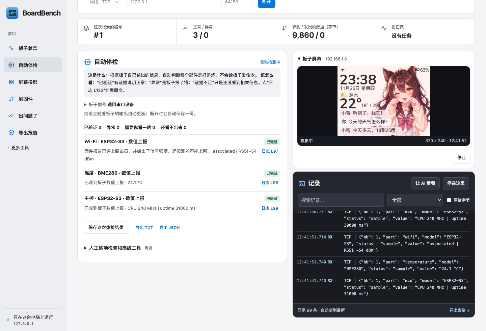

# BoardBench 板子测试台

在 macOS 或 Windows 桌面窗口中控制本机串口，执行板卡验收、观察传感器曲线并导出带原始收发记录的报告。控制页默认在 `http://127.0.0.1:8765`。USB 和串口检测在本机完成，语音回声测试（小智）可以临时开启独立的局域网监听。

图中通过本地 TCP 测试夹具收发数据，右侧投影来自模拟板端的 320 × 240 JPEG 接口。右上角可切换明暗主题，使用系统字体，图标和设备示意图随软件离线提供。

## 启动

- 从 [Releases](../../releases) 下载桌面包。Mac（Apple Silicon）解压得到 `BoardBench.app`，可拖入“应用程序”后双击打开。Windows x64 解压后双击 `BoardBench.exe`。两者都使用系统窗口，关闭窗口即结束本次采集并释放串口。无需安装 Python。
- Mac 使用系统 WebKit，Windows 使用 [Microsoft Edge WebView2 Runtime](https://developer.microsoft.com/microsoft-edge/webview2/)。若 Windows 缺少运行时，请安装微软提供的运行时。Releases 里的 Mac 包未经 Apple 公证，Windows EXE 未签名。首次使用请查看[下载校验与打开步骤](docs/distribution.md#安装)。正式发行版的证书准备、签名及验签方法见[维护者发布流程](docs/distribution.md#维护者发布已签名版本)。
- 从源码运行推荐 Python 3.12。macOS 双击 `macOS.command`，Windows 双击 `Windows.cmd`。脚本首次创建虚拟环境并安装依赖。也可运行 `python -m pip install -r requirements.txt` 和 `python app.py`。
- `--browser` 在系统浏览器打开，`--no-browser` 仅启动本机服务。串口和日志均由本机进程处理。默认端口已占用时可关闭原实例，或使用 `--port 8766`。应用内支持导入检查清单、导出报告及切换明暗外观。
- 用 USB **数据线**连接，选好板子（USB 端口）、速度（波特率）和数据格式。Windows 如无法枚举，请检查设备管理器和板载 USB 转串口芯片的驱动。关闭其他占用端口的串口监视器。

面板的“怎么连”支持 USB 线（串口）、网络 · TCP 和网络 · UDP。网络板填“板子的网络地址”和固件实际监听的“端口号”，三种连接方式共享发命令、检查、读数曲线和记录。UDP 启用后日志会显示本机接收端口，首次收包可确认对端有响应。

## 使用指南

| 要做什么 | 从哪里开始 |
|---|---|
| 接上 USB、选择板型、看部件和日志 | [连接与测试](docs/testing.md) |
| 运行体检、刷固件、测语音 | [自动体检](docs/testing.md#自动体检) · [刷固件](docs/testing.md#刷固件) · [语音回声](docs/testing.md#语音回声测试小智) |
| 回看一次测试、分享故障、使用 AI 分析 | [回放与诊断](docs/diagnostics.md) |
| 校验下载、处理首次启动提示 | [安装与签名发布](docs/distribution.md) |

## 屏幕投影

[征辰 r5 固件源码和编译步骤](firmware/ZhengchenClock/README.md)

**USB 自动识别（默认，保留官方云）**：打开 BoardBench，接数据线到板子的调试串口。面板被动等固件报告 USB 截图能力，确认支持后自动打开预览，直接通过同一串口读取真实画面。普通启动日志、板型名和 USB 桥型号都不足以确认能否截图。页面区分未报告、显示驱动无法截图、仅报告局域网地址和已可取帧。无需更换 OTA、开启回声服务或输入 Wi-Fi 配对码。配套 USB 固件见[面包板接入说明](firmware/XiaozhiScreenMirror/README.md)。

USB 根据设备实际使用的协议识别，与板型、屏幕分辨率和语音服务器无关。支持 BBS1 分段截图、`snap` 命令返回的 LBSNAP JPEG，以及设备主动推送的 LBSNAP 完整帧。识别到截图控制台或 `LBSNAP:READY snap` 时自动请求；只收到主动推送的画面时只接收。错过控制台启动日志、且确认固件支持 `snap` 时，可在画面来源选「USB 已知截图命令 · snap」并点击开始。普通串口日志无法提供屏幕像素，自动模式在能力未知时只监听。

**小智标准截图**适用于在本地 WebSocket v1 会话中公开 `self.screen.snapshot` 的设备。进入「语音回声」开启局域网服务，记下并临时更换设备 OTA 地址，等待设备签到并唤醒以完成握手。然后在「板子屏幕 → 画面来源」选「小智标准截图 · 本地会话」，点击「开始投影」。软件按小智 MCP 协议分页查询真实设备的截图能力，向设备逐帧请求画面，不需要填写型号或截图路径。这个模式使用本地测试服务；结束后恢复原 OTA 地址即可重新使用原云端。只签到未握手、设备未上报截图工具和截图超时会分别提示。没有物理显示的设备没有屏幕画面。

**设备截图地址**适用于提供 HTTP 单帧截图接口的固件，可以在设备连接小智官方云时并行使用。电脑和板子连同一个局域网。在征辰时钟天气固件 **r5** 上连按三次 BOOT 键（r4 的入口是双击音量加），把板子显示的 IP 和六位配对码填进 BoardBench 的「屏幕投影」，点击「开始投影」。支持征辰 Camera Wi-Fi 和 ML307 双网络版的 Wi-Fi 模式。首次配对提示消失后即可看到时钟、天气和对话等实际渲染画面。刷入旧版 r3 的设备需要更新固件才能使用这个入口。

画面来自板端 LVGL 截图，适合观察界面和文字变化。板端两次采集至少间隔 900 毫秒，面板在上一帧完成后等待 1.2 秒再取下一帧。在「板子状态」「自动体检」「发命令」「语音回声」「读数曲线」或「出问题了」展开「板子屏幕」，可直接配对。桌面右侧上方看屏幕、下方看日志，左侧继续测试；窄窗口把预览放到测试区上方。测试页之间切换会沿用同一条投屏连接。收起预览、点「停止」、离开这些页面和投影页或隐藏窗口会停止拉取。再次连按三次 BOOT（r4 为双击音量加）、Wi-Fi 断开或开启满十分钟会关闭板端共享。实物背光、坏点和排线仍需看实体屏。

ESP32-S3 Wi-Fi 面包板有两种配套投屏构建：ST7789 240×320 彩屏、SSD1306 128×64 OLED。双击 BOOT 开关投屏，串口显示 IP，屏上显示六位配对码。[引脚、选包和构建说明](firmware/XiaozhiScreenMirror/README.md)

其他板型可在桌面端填写固件提供的局域网 IPv4、端口和单帧截图路径。例如端口为 80 的设备填 `192.168.1.50:80`、路径填 `/lcd/frame.png`。默认仍是 8088 端口的 `/screen.jpg`。支持 JPEG 和静态 PNG，根据画面的实际尺寸显示。单帧上限 1 MiB、约 420 万像素，配对码只发往所填设备。板子需要能从显示驱动取得画面并提供截图接口。

## 联网与隐私

- **桌面软件**不含统计、遥测或自动更新请求，界面字体和图标随软件离线提供。串口记录和历史库只保存在本机用户目录的 `.boardbench`。唯一会向外发送内容的功能是「AI 帮我看」：只有点了“发送并分析”才发送，内容是预览里已遮盖的诊断正文，目的地是你自己填的接口。遮盖范围与“分享故障记录”相同：密钥、MAC、IPv4、网址、邮箱、UUID、序列号。明文 `http://` 只允许本机和局域网地址，公网接口必须用 `https://`。
- **配套征辰时钟固件**（运行在板子上，与电脑软件无关）联网后会查天气，过程会把板子所在网络的公网 IP 暴露给第三方服务：
  1. 先请求 `https://ip9.com.cn/get`，失败再请求 `https://ipwho.is/`，用公网 IP 估计所在城市和经纬度。请求不带账号、MAC 和序列号，这两个服务只会看到公网 IP。
  2. 再请求中央气象台 `https://www.nmc.cn/rest/`（用城市对应的气象站编号）。取不到时，把城市级经纬度（保留两位小数）发给 `https://api.open-meteo.com/`。
  3. 每次联网定位一次，之后约每 30 分钟更新天气，失败 1 分钟后重试。定位失败时回退到深圳。ML307 的 4G 模式走蜂窝网络发出同样的请求。
  4. 固件**没有关闭开关**。对小智助手说城市名会调用 `self.screen.set_weather_city`，改用该城市坐标、不再做 IP 定位，但仍会请求天气服务，且只对本次联网有效。要完全不联网查天气，自行编译时删去 `desk_display.cc` 中的 `StartDeskWeather()` 调用，或不使用这套固件。语音对话仍走小智官方云，与天气请求无关。

## 设备与能力

| 设备 / 固件 | 可用功能 |
|---|---|
| 能枚举为串口的 MCU、USB-TTL 和仪表 | 发命令、原始字节、读数曲线、备注、自定义检查清单、导出报告 |
| esptool 支持的 ESP 芯片 | ROM 识别、MAC、Flash ID 和识别容量，输出依芯片和下载模式而异 |
| 征辰 AI Camera Wi-Fi / Wi-Fi＋ML307 | 专属检查清单、启动 SKU 和已知固件日志；r5 横屏时钟固件增加屏幕投影，并会联网查天气（见「联网与隐私」） |
| ESP32-S3 单麦 Wi-Fi 面包板 | 启动、联网和语音会话检查清单；MQTT 握手错误可归到语音连接记录 |
| CircuitPython REPL | 启动标识、机器信息、堆内存检查，需先进入 `>>>` |
| 自定义传感器固件 | 用一行 JSON 上报温度、湿度、气压及型号，例如 `{"bb":1,"part":"temperature","model":"BME280","status":"sample","value":"24.6 °C"}`；器件驱动由板端提供 |
| MicroPython REPL | 机器信息、堆内存、CPU、设备 ID、文件系统。需要先进入 `>>>` |
| 可更改 OTA 的小智 WebSocket v1 固件 | 局域网签到、语音握手、短录音原帧回送、屏幕测试文字。听感和画面由操作者确认 |
| 正点原子 DNESP32S3B BOX | 套装外设验收清单，覆盖按键、显示、音频、TF 卡、传感器、EEPROM、USB、扩展接口、可选摄像头等 |
| 配套 BoardBenchProbe 固件 | 有应答判定的串口、芯片资源、片内 SRAM / PSRAM 小块读写、Wi-Fi 扫描、连续遥测。针对已核对板型的一代 BOX，还提供 I²C 地址枚举 |

## 项目目录

| 位置 | 内容 |
|---|---|
| `app.py`、`macOS.command`、`Windows.cmd` | 源码启动入口 |
| [boardbench/](boardbench/) | 本地服务、桌面窗口和测试会话 |
| [boardbench/devices/](boardbench/devices/) | 设备识别、监控、投屏和固件烧录 |
| [boardbench/checks/](boardbench/checks/) | 板型、检查清单、应答和稳定性测试 |
| [boardbench/reports/](boardbench/reports/) | 日志回放、报告导出和 AI 分析 |
| [web/](web/) | 桌面窗口使用的界面与静态资源 |
| [firmware/](firmware/) · [examples/](examples/) | 配套板端固件和检查清单示例 |
| [tests/](tests/) · [scripts/](scripts/) · `package_app.py` | 自动测试、签名发布和桌面打包 |

构建、测试命令及上游项目见[开发与验证](docs/development.md)。
