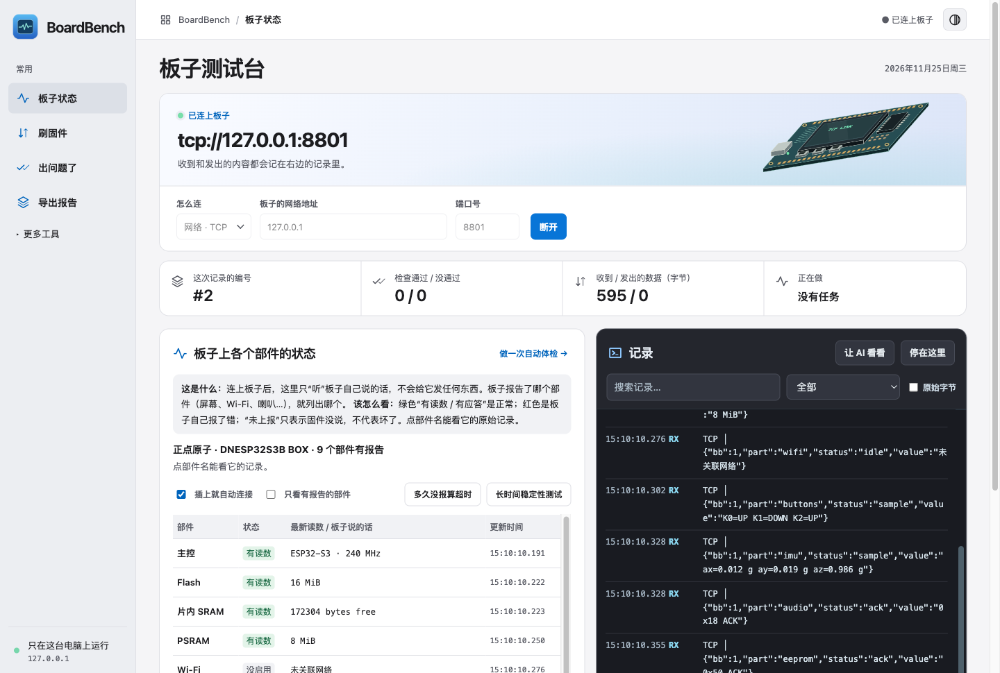
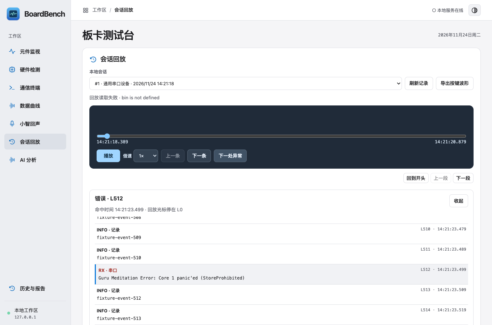

# BoardBench 板卡测试台

在 macOS 或 Windows 桌面窗口中控制本机串口，执行板卡验收、观察传感器曲线并导出带原始收发记录的报告。控制页默认在 `http://127.0.0.1:8765`。USB 和串口检测在本机完成，小智回声测试可以临时开启独立的局域网监听。

截图使用本机 TCP 回环夹具。右上角可切换明暗主题，使用系统字体，图标和设备示意图随软件离线提供。

## 启动

- 从 [Releases](../../releases) 下载桌面包。Mac（Apple Silicon）解压得到 `BoardBench.app`，可拖入“应用程序”后双击打开。Windows x64 解压后双击 `BoardBench.exe`。两者都使用系统窗口，关闭窗口即结束本次采集并释放串口。无需安装 Python。
- Mac 使用系统 WebKit，Windows 使用 [Microsoft Edge WebView2 Runtime](https://developer.microsoft.com/microsoft-edge/webview2/)。若 Windows 缺少运行时，请安装微软提供的运行时。发布包未做 Apple 开发者公证或 Windows 商业代码签名。
- 从源码运行推荐 Python 3.12。macOS 双击 `macOS.command`，Windows 双击 `Windows.cmd`。脚本首次创建虚拟环境并安装依赖。也可运行 `python -m pip install -r requirements.txt` 和 `python app.py`。
- `--browser` 在系统浏览器打开，`--no-browser` 仅启动本机服务。串口和日志均由本机进程处理。默认端口已占用时可关闭原实例，或使用 `--port 8766`。应用内支持导入配置、导出诊断报告及切换明暗外观。
- 用 USB **数据线**连接，选择端口、波特率、串口格式。Windows 如无法枚举，请检查设备管理器和板载 USB 转串口芯片的驱动。关闭其他占用端口的串口监视器。

面板支持 USB 串口、TCP 客户端和 UDP 对端。网络板填设备地址和固件实际监听的端口，三种连接方式共享终端、命令测试、曲线和日志。UDP 启用后日志会显示本机接收端口，首次收包可确认对端有响应。

## 插 USB 查看元件与日志

首页是“元件监视”。首次使用，线接到板上标注 **UART / USB 转串口** 的数据口，选择端口、115200、8N1 并点连接。下次只自动连接匹配已选设备的 VID、PID 和序列号的唯一端口。USB 桥未提供可用序列号、存在重复标识或换了设备时，请手动选择。手动断开后，在该端口拔出以前不会自动重连。

监视页按元件列出状态、实际数值和最后更新时间。点击元件后右侧显示本会话该元件最近 200 条原始日志。全量日志仍可导出。原厂固件输出的已识别 ESP-IDF 标签只标为“固件日志 / 固件报错”；未上报的元件保持“未上报”。断线、周期上报超时、I²C 无应答、仅知道控制引脚状态均有不同标记。

配套探针以每两秒一次的频率从板端上报数据。通用版读取主控、Flash、内存、Wi-Fi 和蓝牙驱动状态。一代 ATK-DNESP32S3B BOX 专版使用经核对的 SDA 48 / SCL 45，增加 QMI8658A 六轴读数、三个按键、XL9555、预期 EEPROM 地址应答、音频芯片候选地址及屏幕背光、功放、红灯的控制状态。控制电平无法判断屏幕实际像素、亮度或声音。未集成驱动的部件会明确标出原因。以上串口遥测不会写 EEPROM 或 TF 卡。硬件依据见 [Zephyr 板型定义](https://github.com/zephyrproject-rtos/zephyr/tree/main/boards/alientek/dnesp32s3b)、[原厂资料](https://www.openedv.com/docs/boards/esp32/ATK-DNESP32S3BVXX.html) 和 [QMI8658A 手册](https://www.qstcorp.com/upload/pdf/202301/13-52-25%20QMI8658A%20Datasheet%20Rev%20A.pdf)。

自定义固件可逐行输出 JSON。例 `{"bb":1,"part":"imu","status":"sample","value":"ax=0.02 g"}`。部件键允许小写字母、数字、下划线、中划线或点。状态支持 `sample`、`ack`、`control`、`idle`、`error`、`missing`、`unavailable`。正常周期应小于 8 秒。

默认监视只打开串口接收数据，未启用 DTR / RTS 流控，软件不自动发送命令、复位或烧录。部分 USB 驱动在打开端口时可能短暂切换控制线。连接 USB 时按板型说明使用数据口；外部 5V、PH2.0 线序或外设负载需由实物接线保证。历史库及 WAL 达到 256 MiB 或剩余磁盘低于 1 GiB 时停止采集，保留已有记录。长日志按块导出。归档时先退出应用，再整体移动用户目录下的 `.boardbench` 数据目录。

## 第一次测一块板

1. 在“测试配置”中选板型并点击“新建测试”。同一端口换了另一块实物也要新建测试。固件和 PCB 改版信息可以写入“通信终端 → 测试备注”。
2. 有出厂小智固件的一代正点原子 BOX 选择 **正点原子 · DNESP32S3B BOX**。观察原固件的屏幕、按键与语音反馈。选择 ESP ROM 探测会关闭当前串口监视、让设备复位进下载模式、读取芯片和闪存标识；操作结束后可以重新连接。自动复位失败时参照本板的 BOOT / RESET 说明进入下载模式。
   “备份 Flash”可读出整片 Flash，完成后从历史报告下载 BIN；同页显示 SHA-256。备份中可能包含 Wi-Fi 与应用凭证，按私密文件保存。
3. “通信终端”可发送 UTF-8、HEX，选择 CRLF、LF、CR 或无行尾。“数据曲线”显示 JSON 数值字段、数值 CSV 或 key=value 的输入。
4. 展开检测项目执行命令或记录实测现象。自动检测发送指定命令，等待本次收到的应答；失败和超时均有独立记录。人工项可标记通过、失败或跳过，必须填写依据。未操作的项目在报告中标为未测。
5. 在“历史与报告”导出 TXT 结论、JSON 完整会话或 CSV 事件流。页面显示最近 350 条，完整日志持久化在用户主目录的 `.boardbench/history.sqlite3`。原始串口内容可能包含设备标识、配网信息，分享报告前请检查。

## 水平仪、回放和按键波形

- 在 **数据曲线 → 板子水平仪** 中缓慢倾斜板子，观察气泡、横滚角和俯仰角。原版 BOX 诊断固件的六轴上报会同时生成三个加速度和三个角速度通道。将板子靠在参考面上可点“以当前姿态置零”，偏离参考面不超过 3° 时显示绿色。运动较快、数据过期或断线时暂停角度显示。零点保存在当前界面，重新连接后恢复。姿态估算依赖静止或缓慢移动时的重力方向。[Adafruit 姿态算法](https://github.com/adafruit/Adafruit_AHRS/blob/master/src/Adafruit_Simple_AHRS.cpp) · [模拟器件倾角测量原理](https://www.analog.com/en/resources/app-notes/an-1057.html)
- 用 **静置采样** 采集当前连接的五组有效读数，检查加速度模长、各轴波动和陀螺零速输出，结合日志编号复查安装方向、振动或漂移。点击“存入会话日志”可将五组原始值及摘要一并写入本次报告。
- 在 **会话回放** 选择一轮记录，或从“历史与报告”点“回放”。可以播放、暂停、变速、逐条查看，或拖动本段的时间轴检查故障前后的事件与元件输出。回放打开时固定日志上界，后续新增事件可通过“刷新记录”载入。点“下一处异常”可跨段定位告警或错误并查看前后原文。长会话分段读取，跨段继续播放；回放只读取本机归档。交互参考了 [PlotJuggler](https://github.com/PlotJuggler/PlotJuggler) 的时间序列浏览。
- 同页点 **导出按键波形** 可生成标准 VCD 文件，在 [GTKWave](https://github.com/gtkwave/gtkwave) 中查看 K0、K1、K2。需要固件上报三个按键的完整电平。低电平表示按下，高电平表示松开；断线、无效读数和采样超时用 `x` 表示。横轴采用电脑收到日志的毫秒时间，适合查看按键先后顺序，机械触点抖动的精密测量需要更高采样率的仪器。

## 智能检测

进入“硬件检测”即可查看当前连接的自动判读。每项结果说明验证到了什么，可以点日志编号核对原文。普通出厂固件可以提供串口及部分启动、联网日志，诊断固件还会提供传感器采样、按键电平等结构化数据。当前连接缺少读数时显示证据不足，需要实物观察的项目可以留空；浏览其他结果和导出报告都能继续。整个判读过程只使用本机收到的信息。

TXT 和 JSON 报告包含导出时的实时判读。需要保留中间状态时可保存快照，结束有收包记录的连接时会自动保存最后观测。历史快照保留当时的判断及日志出处。

## 可选的人工整板验收

展开硬件检测页的人工验收可执行当前选中的配置，切换板型后可以沿用已经打开的设备连接。**一键整板检测**先顺序执行全部命令项，再按操作场景确认外设。出厂小智配置的 19 项分为上电与复位、按键显示与语音、指示与传感器、存储器、扩展与接口五组。**日常快测**仅保留核心分组和快速命令。点同一组的提交按钮可以一次确认多项；失败项需要记录现象，跳过和停止分别留痕。界面刷新后可继续当前组，报告保留每一轮的范围与单项结果。

配套诊断固件可自动执行芯片、内存、Wi-Fi 和 I²C 等命令项。出厂固件未提供控制命令的外设采用现场观察。没有设备连接时，命令项记录为跳过。ROM 复位探测和 Flash 备份仍从各自的按钮启动。自定义配置可增加 `group` 组织现场步骤、`quick: false` 将项目排除在快测之外。

## AI 分析

通过日志旁的“分析本次测试”、左侧“AI 分析”或历史记录进入。模型和接口设置支持 OpenAI 兼容的 Chat Completions API。

1. 填写 API 地址，例如本机 Ollama 的 `http://127.0.0.1:11434/v1`、LM Studio 的 `http://127.0.0.1:1234/v1`，或自己的 HTTPS 网关。也可填写完整的 `/chat/completions` 路径。服务端须已加载可用模型。
2. 按需填写 API Key、输入模型名，或点击“读取模型列表”。“测试连接”向所选模型发送最小请求，不包含板卡日志。地址与模型保存在本地；密钥默认仅在进程内使用，勾选记住后交给系统钥匙串。换地址时密钥不会带到新服务。
3. 选择会话与范围，填写问题并预览。预览列出抽样条数、实测结论、未测项目和将发送的诊断正文，可检查自动遮盖后的内容。点击“发送并分析”才会发送这份快照。原始 HEX、音频和 Flash 镜像不进入诊断正文。
4. 点击模型结论下方的 L 编号查看原始日志，R 编号查看当时的检测结果。无效引用标为待确认；未按格式提供证据的回复显示为未核验文本。每次分析及其证据快照单独归档在所选会话中，TXT / JSON 报告包含 AI 分析。实测状态仅由检测操作产生。

## 设备与能力

| 设备 / 固件 | 可用功能 |
|---|---|
| 能枚举为串口的 MCU、USB-TTL 和仪表 | 串口收发、原始字节、曲线、操作备注、自定义测试、历史报告 |
| esptool 支持的 ESP 芯片 | ROM 识别、MAC、Flash ID 和识别容量，输出依芯片和下载模式而异 |
| MicroPython REPL | 机器信息、堆内存、CPU、设备 ID、文件系统。需要先进入 `>>>` |
| 可更改 OTA 的小智 WebSocket v1 固件 | 局域网签到、语音握手、短录音原帧回送、屏幕测试文字。听感和画面由操作者确认 |
| 正点原子 DNESP32S3B BOX | 套装外设验收清单，覆盖按键、显示、音频、TF 卡、传感器、EEPROM、USB、扩展接口、可选摄像头等 |
| 配套 BoardBenchProbe 固件 | 有应答判定的串口、芯片资源、片内 SRAM / PSRAM 小块读写、Wi-Fi 扫描、连续遥测。针对已核对板型的一代 BOX，还提供 I²C 地址枚举 |

### 自定义测试

下载内置配置或编辑 [示例配置](examples/serial-device.json)，把 `tx` 换成固件支持的命令、`expect` 换成只在有效应答中出现的文本。导入后选择配置并新建测试。`timeout` 单位为秒，范围 1–60；文本命令默认附加 CRLF。可选字段 `encoding` 支持 `text`、`hex`，`ending` 支持 `CRLF`、`LF`、`CR`、`none`，HEX 默认无行尾。`reject` 可配置设备的明确失败应答。固件会回显命令时，应选择与 TX 不同的应答标志。“运行命令项”依次执行配置内全部串口命令；单项结果和每次尝试的收发保留在日志里。

### 小智回声

让板子和电脑连同一局域网。打开“小智回声”，填写电脑在该局域网的 IPv4 地址并开启监听。先记下板上的原 OTA 地址，再把面板生成的地址填入板子配网页。设备下次签到后按键或唤醒，报一串数字；收到停止录音或累积约 3 秒的 Opus 帧后，测试台向板子回传。录音仅在内存中缓存。测完关闭监听并恢复原 OTA。若仅签到没有握手，请检查固件是否允许自定义 OTA、WebSocket v1、明文局域网连接，以及电脑防火墙。固定 MQTT 固件需要相应网关。这一模式可独立于云端账号或大模型使用。

### 配套诊断固件

[BoardBenchProbe](firmware/BoardBenchProbe/BoardBenchProbe.ino) 使用 Espressif Arduino core，编译目标为实际 ESP32 板型。用 Arduino IDE 打开同名目录，选择对应芯片、串口及正确的 PSRAM 类型。烧录此程序会替换当前应用；保留出厂小智时使用面板的出厂固件配置即可。串口速度 115200。通用固件不在启动时配置板载外设引脚；专版仅接受原版 BOX 的固定 I²C 总线。地址应答只能表明该地址有设备。整屏纯色测试、传感器物理量、TF 文件校验和摄像头预览需要相应板型的例程或固件命令，面板支持把这些命令加入配置。

## 借鉴和依赖

- 串口枚举与传输采用 [pySerial](https://github.com/pyserial/pyserial)，ESP ROM 探测调用 [esptool](https://github.com/espressif/esptool)。
- 可配置检测项目和实时串口趋势参考 [Serial Studio](https://github.com/Serial-Studio/Serial-Studio) 与 [SerialPlot](https://github.com/hyOzd/serialplot)，界面和绘图代码在本项目中实现。
- 本地回声使用 [xiaozhi-esp32 的 WebSocket 协议](https://github.com/78/xiaozhi-esp32/blob/main/main/protocols/websocket_protocol.cc)。一代 BOX 的 I²C 引脚参考 [对应板级实现](https://github.com/78/xiaozhi-esp32/tree/main/main/boards/alientek/atk-dnesp32s3-box)。

## 验证

`python -m unittest discover -s tests -v` 检查串口收发、应答和超时、取消、会话隔离、报告导出以及局域网音频往返。Unix 另外通过实际系统伪终端测试收发。姿态计算及静置采样使用 `node --test tests/motion.test.cjs` 检查。跨平台打包使用 `python -m pip install pyinstaller`、`python package_app.py` 和 `python tests/smoke_binary.py`。CI 编译 ESP32-S3 配套固件。协议测试和打包检查不能代替实物验收。
