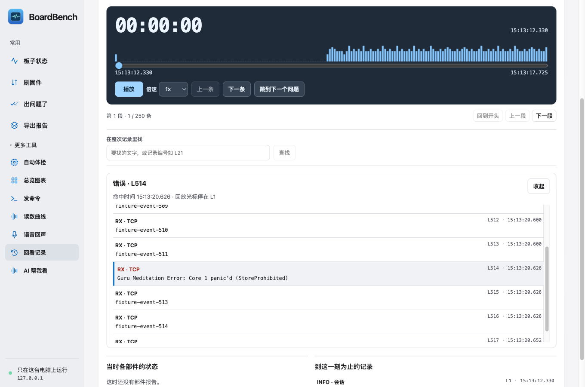

# 回放与诊断

## 水平仪、回看和按键波形

- 在 **读数曲线 → 板子水平仪** 中缓慢倾斜板子，观察气泡、横滚角和俯仰角。原版 BOX 诊断固件的六轴上报会同时生成三个加速度和三个角速度通道。将板子靠在参考面上可点“把现在的角度当作水平”，偏离参考面不超过 3° 时显示绿色。运动较快、数据过期或断线时暂停角度显示。零点保存在当前界面，重新连接后恢复。姿态估算依赖静止或缓慢移动时的重力方向。[Adafruit 姿态算法](https://github.com/adafruit/Adafruit_AHRS/blob/master/src/Adafruit_Simple_AHRS.cpp) · [模拟器件倾角测量原理](https://www.analog.com/en/resources/app-notes/an-1057.html)
- 在 **放稳了测一下** 点“采集 5 组”，采集当前连接的五组有效读数，检查加速度模长、各轴波动和陀螺零速输出，结合日志编号复查安装方向、振动或漂移。点“记到记录里”可将五组原始值及摘要一并写入本次报告。
- 在 **回看记录** 的“哪次记录”里选一轮，或从“导出报告和以前的记录”点“回看”。可以播放、暂停、变速、逐条查看，或拖动本段的时间轴检查故障前后的事件与部件输出。回放打开时固定日志上界，后续新增事件可点“载入最新内容”载入。点“跳到下一个问题”可跨段定位告警或错误并查看前后原文。长会话分段读取，跨段继续播放；回放只读取本机归档。交互参考了 [PlotJuggler](https://github.com/PlotJuggler/PlotJuggler) 的时间序列浏览。
- **在整次记录里找** 支持按内容、来源、等级或日志编号（如 `L21`）跨段查找。匹配行会和前五条、后三条记录一起显示。点“从这条开始计时”，再查第二条，可看到两者在电脑上的记录时间差（毫秒）。搜索范围固定在打开回放时，点“载入最新内容”可纳入新数据。设计参考 [klogg 的长日志检索](https://github.com/variar/klogg) 和 [Wireshark 的时间参考点](https://www.wireshark.org/docs/wsug_html_chunked/ChWorkTimeFormatsSection.html)。
- 同页点 **导出按键波形** 可生成标准 VCD 文件，在 [GTKWave](https://github.com/gtkwave/gtkwave) 中查看 K0、K1、K2。需要固件上报三个按键的完整电平。低电平表示按下，高电平表示松开；断线、无效读数和采样超时用 `x` 表示。横轴采用电脑收到日志的毫秒时间，适合查看按键先后顺序，机械触点抖动的精密测量需要更高采样率的仪器。

## 故障记录与标准样板

- 点左侧“导出报告”，在“导出报告和以前的记录”里选一轮，点“分享故障记录”。文件保留连接设置、可识别的芯片和固件标识、测试名称和结果、最近日志及最多八处异常前后文。预览会遮盖常见密钥、设备标识、IPv4 地址、网址与邮箱；请检查设备自定义输出，预览区支持删除敏感内容。闪存备份、密钥设置及原始 HEX 字节均不在故障记录内。
- 点“导出报告”里的“打开别人发来的故障记录（可以拖进来）”，或把文件拖到该按钮，程序会创建独立的离线历史记录，可回看，或从“导出报告和以前的记录”进入“AI 帮我看”。导入不执行测试命令，不改变实时连接；重复打开相同内容复用同一记录。AI 仍由操作者预览后发送。
- 连接板子后，在“板子状态”页点“长时间稳定性测试”，填写“板子型号和配件”，在“测多久（分钟）”里设置 1 分钟至 7 天的记录时长。它利用现有接收数据，记录设备身份、每个部件最近的状态、已观测周期部件的最长静默、可识别的 ROM 启动次数，以及从 ROM 到首次主控上报或探针就绪的时间。时间来自电脑接收端，未捕获启动过程时该值留空。拔线、切换会话、到时和手动结束分别留痕；程序意外退出保留最近落盘的进度。
- 在“导出报告和以前的记录”里点“稳定性测试记录”，把正常结束的记录“设成标准样板（以后拿来对比）”，再对另一轮点“和标准样板比一比”。界面同时列出两轮时长、固件、启动时间、部件状态和最长静默，优先核对相同板型及选装规格。只有设备确实上报的部件才有观测结果。

## AI 帮我看

通过记录旁的“让 AI 看看”、左侧“AI 帮我看”或“导出报告和以前的记录”里的“AI 帮我看”进入。“设置用哪个 AI”支持 OpenAI 兼容的 Chat Completions API。

1. 填写 API 地址，例如本机 Ollama 的 `http://127.0.0.1:11434/v1`、LM Studio 的 `http://127.0.0.1:1234/v1`，或自己的 HTTPS 网关。也可填写完整的 `/chat/completions` 路径。明文 `http://` 仅限本机和局域网地址（`localhost`、127.x、10.x、172.16–31.x、192.168.x、`*.local`）；公网地址必须用 `https://`，否则不会保存，也不会发送密钥。服务端须已加载可用模型。
2. 按需填写 API Key、“模型名称”，或点击“读取模型列表”。“测试连接”向所选模型发送最小请求，不包含板卡日志。地址与模型保存在本地；密钥默认仅在进程内使用，勾选“使用系统钥匙串记住密钥”后交给系统钥匙串。换地址时密钥不会带到新服务。
3. 选“哪次记录”和“给 AI 看哪些内容”，在“想查什么”里写问题，点“先看看要发什么”预览。预览列出抽样条数、实测结论、未测项目和将发送的诊断正文，可检查自动遮盖后的内容；遮盖与分享故障记录相同（密钥、设备标识、IPv4 地址、网址、邮箱、UUID、序列号），预览显示的就是实际发送的内容。点击“发送并分析”才会发送这份快照。原始 HEX、音频和 Flash 镜像不进入诊断正文。
4. 点击模型结论下方的 L 编号查看原始日志，R 编号查看当时的检测结果。无效引用标为待确认；未按格式提供证据的回复显示为未核验文本。每次分析及其证据快照单独归档在所选会话中，TXT / JSON 报告包含 AI 分析。实测状态仅由检测操作产生。
